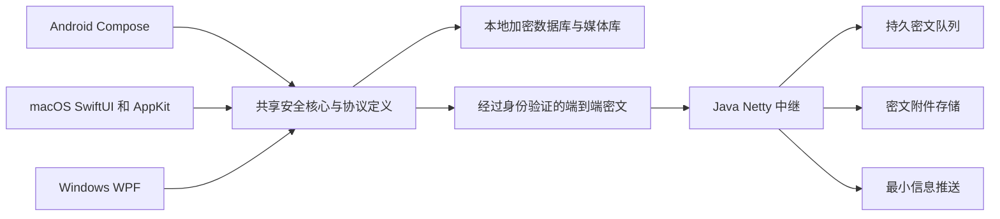

# MsgAT 客户端和服务端重构规划与执行方案

本方案覆盖 Android、macOS、Windows 和 Java 服务端，从账号身份、加密链路、本地存储、消息投递，到 Telegram 风格的界面、日常操作、云端构建和实际使用验收。

当前采用普通设备上的高安全方案。根私钥代表账号，创建后不提供导出、导入、复制登录、跨设备迁移或恢复；Reset Identity 是主动销毁身份的入口。三端功能与消息语义对齐，界面继续采用各自原生技术，桌面保留双栏。

本方案已于 2026 年 11 月 8 日获准开始执行。用户同意采用 libsignal 并遵守客户端 AGPL 发布要求，本次大重构允许本地构建和必要的依赖恢复，完成后恢复云端构建。所有工作、实际验收和交付完成后，将 GitHub 仓库改为 private；当前不提前更改可见性。实际进度以 REBUILD_STATUS.md 为准。旧用户和旧服务端数据可在正式切换时舍弃，重构中不因缓存清理误删运行数据。

## 已确定的产品约束

| 项目 | 约束 |
| --- | --- |
| 安全目标 | 防止网络窃听、服务器读取聊天、普通恶意进程越权和离线文件失窃；操作系统或内核被完全控制不在本次范围 |
| 身份定义 | 随机根私钥种子是唯一身份根；手机号、昵称、设备编号、生物识别均不构成账号身份 |
| 身份生命周期 | 创建后固定在原安装环境使用；不提供迁移、恢复、导出种子或同身份多设备登录 |
| 身份销毁 | Reset Identity 明确确认后销毁身份与本地密钥；正常升级保留当前身份 |
| 加密归属 | 持久数据密钥从根种子分用途派生或由其派生密钥封装；通信密钥由根身份认证，并引入协议所需的新随机性 |
| 数据兼容 | 新架构可从空白数据部署，不承担旧协议和旧数据库兼容包袱 |
| UI | 参考 Telegram 官方三端的布局、密度、动效和操作；Android Compose、macOS SwiftUI/AppKit、Windows WPF |
| 桌面布局 | 默认双栏，可调整侧栏宽度；窄窗口自适应，不能重新做成固定的手机放大版 |
| 本地表情 | 支持微信、QQ 可识别的本地素材与表情包导入，支持静态及动图 |
| 日常交互 | 文件拖放确认、默认浏览器开链接、Enter 发送、Shift＋Enter 换行、快捷键、草稿和焦点行为完整覆盖 |
| 验收方式 | 以真实客户端和实际服务器操作为依据，不新增凑数、重复实现或与真实使用脱节的测试代码 |
| 构建发布 | 四个组件均使用 GitHub 托管 runner；保留原安卓签名，核对四端包与远端哈希后发布，仅保留最新成功 Release |

“身份与设备无关”指身份不从设备信息计算；“身份不可迁移”指产品不提供将该身份转移到另一设备的能力。三种客户端之间是不同身份相互通信，不再规划同一身份的多端登录或历史同步。

密钥无法读取、数据库损坏或硬件保护失效时，不能静默重建身份覆盖旧数据。界面应保留故障现场，并让用户明确选择处理或 Reset Identity。

解锁后的明文仍会经过本机内存、输入和显示通道。用户授予其他程序录屏、辅助功能、输入法或调试权限时，内容也可能被读取；部分桌面进程访问甚至只需同用户权限。高安全版通过平台隔离、最小权限、正式签名和减少明文驻留降低风险，不把磁盘加密宣称为对所有本机进程的绝对隔离。

## 总体架构与技术选择

客户端采用原生界面、共同的业务协议和统一的安全规则。三端共享同一份事件定义、错误码和状态机；加密协议与关键存储操作优先集中到可复用的安全核心，减少三份实现逐渐出现差异。

| 层级 | 建议技术 | 选择理由 |
| --- | --- | --- |
| Android UI | Kotlin、Compose 与系统媒体及文件接口 | 保留原生交互、输入法与系统分享支持 |
| macOS UI | SwiftUI；文本编辑、拖放和媒体等处使用 AppKit 桥接 | 保留原生双栏、菜单、窗口与快捷键 |
| Windows UI | C#、WPF、MVVM，升级到受支持的 .NET 10 LTS | 保留 .NET 原生桌面框架，并避免继续依赖临近支持终止的 .NET 9 |
| 安全核心 | Rust 封装经选定的协议实现，通过稳定的 JNI 或 C ABI 供三端调用 | 统一密钥生命周期、消息状态和序列化边界；不自行发明加密算法 |
| 本地数据 | SQLCipher；独立加密媒体对象 | 兼顾事务、分页查询、全文索引和大文件存储 |
| 控制通信 | Netty 长连接，TLS 1.3，带版本和长度上限的二进制消息 | 保留实时性，明确消息边界和资源预算 |
| 附件传输 | 独立于控制消息的流式传输逻辑，分块、恢复、限速 | 大文件不能阻塞回执、消息和通话信令 |
| 通话 | WebRTC、STUN 与可配置 TURN | 处理实际网络穿透，独立于聊天中继 |
| 服务端 | Java 21、Netty、SQLite 元数据与密文对象文件 | 保持单 JAR 部署和现有维护方式，先采用模块化单体 |
| 配置 | JAR 同目录 JSON，默认端口 34478 | 保留可自行部署和修改端口的方式 |

Rust 核心新增的工具链也只在 GitHub 云端准备。稳定 ABI、缓冲区所有权、错误返回和 UI 线程调度必须在接口设计时确定。最低系统版本由协议库和原生绑定的实际支持能力决定，在阶段零冻结，不能先承诺全部旧设备兼容。

.NET 10 属于 LTS；官方当前列出的 .NET 9 支持终止日为 2026 年 11 月 10 日。[Microsoft 支持策略](https://dotnet.microsoft.com/en-us/platform/support/policy/dotnet-core)

默认不引入 Redis、Kafka、微服务集群或全新的服务端语言。只有真实使用表现和容量证据表明需要时，再扩展存储后端或拆分服务。

共同协议优先使用版本化的 Protobuf 事件定义，生成各语言需要的结构；消息外层有明确长度与类型上限。签名和认证上下文使用固定且明确的编码规则，不能假定任意序列化再编码后仍是同一串字节。具体字段和编码在阶段零冻结。

## 加密方案比较与建议

选择依据是公开分析、现实部署、可复用实现、三端适配和维护成本。算法发布得更新，不能单独证明整套应用更安全。

| 候选 | 能力与成熟度 | 本项目采用方式 |
| --- | --- | --- |
| Signal PQXDH 与 Triple Ratchet | 已有现实部署，结合经典棘轮和持续的后量子密钥更新，保护前向保密并在满足条件时支持失陷后恢复 | 单聊首选候选；评审具体实现、许可和三端绑定后冻结 |
| Apple PQ3 | 已用于 iMessage，公开了持续后量子更新设计和安全分析 | 作为设计对照；不假定存在可直接替换本项目三端协议的通用官方 SDK |
| MLS 与 OpenMLS | IETF 群消息标准；OpenMLS 提供 Rust 实现，适合成员变更和群密钥更新 | 群聊首选候选；当前公开常规套件为经典密码，不统一宣传为后量子群聊 |
| 直接组合 ML-KEM 与 ML-DSA | 已有 NIST 标准，分别承担密钥封装和签名 | 作为原语与未来升级评审对象，不能单凭两个原语拼出成熟聊天协议 |
| 继续静态共享密钥加密全部消息 | 改动少，但缺少持续会话密钥更新，长期密钥失窃影响范围大 | 新架构不保留 |
| 自行叠加多层自定义运算 | 难以分析与维护，不能提供可验证的安全提升 | 不采用 |

首选方向是：单聊评估现行 Signal 协议实现，群聊评估 MLS，本地存储采用 SQLCipher 与成熟的认证加密库。所有网络能力必须经过认证协商，不能在失败后静默退回旧的静态加密或公开信息派生密钥。

Signal 的 2025 年升级已包含 SPQR 和 Triple Ratchet，不能再用 Apple 2024 年发布 PQ3 时的对比图判断当前优劣。两者都值得比较其持续更新设计。[Signal 升级说明](https://signal.org/blog/spqr/)、[当前棘轮规范](https://signal.org/docs/specifications/doubleratchet/)、[Apple PQ3 设计](https://security.apple.com/blog/imessage-pq3/)

MLS 标准定义群密钥建立及相关安全属性。OpenMLS 当前列出的常规套件使用 X25519 或 P-256 等经典密码；Android 也需要项目自己承担真实运行适配，不能把上游交叉编译成功当作本项目功能验收。[MLS 标准](https://www.rfc-editor.org/rfc/rfc9420.html)、[OpenMLS 当前实现](https://github.com/openmls/openmls)

ML-KEM 与 ML-DSA 是不同用途的标准；具体实现必须核对标准版本、勘误、随机数要求和协议使用方式。保留 Ed25519 根身份时，也不能把后量子会话保密等同于完整的后量子身份认证。[NIST ML-KEM](https://csrc.nist.gov/pubs/fips/203/final)、[NIST ML-DSA](https://csrc.nist.gov/pubs/fips/204/final)

用户已批准使用 libsignal 并接受客户端 AGPL 发布义务，服务端继续使用 MIT。libsignal 官方明确外部使用不受支持，因此版本固定、原生桥接与升级维护由本项目负责。OpenMLS 等不能被直接宣称为与 Signal 后量子方案能力等同。[libsignal 官方仓库](https://github.com/signalapp/libsignal)

协议的公开分析只支持相应协议与假设，不自动证明 MsgAT 的界面、缓存、绑定或服务端实现安全。独立安全评审属于后续可单独安排的工作，不计作已经完成的验收。

## 根身份与密钥生命周期

### 身份创建与本地保护

每个新身份生成独立的 32 字节高熵根种子。保留现有“种子决定身份”的核心，身份签名、公钥与账号 ID 的格式在协议定版时明确。账号 ID 不从设备编号、昵称、手机号或服务器数据库编号推导。

根种子不显示为助记词，不进入剪贴板、二维码、日志、崩溃报告或可迁移备份。对外二维码只包含公开身份材料和连接所需公开信息。

Android 使用 Keystore 中的硬件保护密钥，优先 StrongBox、其次经核实的 TEE；macOS 使用 Secure Enclave 支持的本机密钥封装种子；Windows 使用 TPM/CNG 保护封装材料。密钥封装与原安装环境绑定，系统云备份和设备到设备迁移不包含身份材料。

生物识别、系统口令和可选应用锁只用于解锁本地封装，不产生另一个账号身份。Mac 钥匙串、Windows DPAPI 等也不能被描述为种子本身永不进入应用内存。完整系统失陷已经排除，但日常处理仍减少明文种子驻留时间。

用户已确认：硬件保护是创建身份的必要条件。Android 必须核实 TEE 或 StrongBox；Mac 必须具备可用的 Secure Enclave（已实际验证无需开发者证书的 CryptoKit 封装存储路径）；Windows 必须具备可用的 TPM/CNG。缺少能力或无法解锁时明确提示并禁止创建身份，不提供软件兼容档。硬件包装不意味着根种子从不进入应用内存；应用使用身份时会短暂解封。

### 密钥归属与用途分离

根种子通过 HKDF 按用途、资料库随机盐、协议版本与密钥代次派生独立分支，禁止直接将同一段私钥同时用于数据库、网络和附件加密。[HKDF 规范](https://www.rfc-editor.org/rfc/rfc5869.html)

| 密钥类别 | 与根身份的关系 | 生命周期 |
| --- | --- | --- |
| 身份签名密钥 | 根种子决定 | 直到 Reset Identity |
| 本地库封装密钥 | 根种子按数据库用途派生 | 可按库版本或代次轮换 |
| 数据库数据密钥 | 由库分支安全封装的独立随机密钥 | 按需轮换，不改变账号 |
| 附件密钥 | 每个对象独立生成，由本地根分支或会话消息保护其归属与分发 | 随对象创建及回收 |
| 协议身份及预密钥 | 由根身份签名绑定，遵循所选协议的密钥生成要求 | 按协议更新和消耗 |
| 消息棘轮密钥 | 在已认证会话中派生，包含新随机贡献 | 持续更新，及时清除旧状态 |
| 通话密钥 | 由已认证信令绑定，按 WebRTC 或群媒体协议协商 | 每次通话独立 |
| 服务端证书与运维密钥 | 服务实例自己的基础设施身份，不是用户私钥 | 独立轮换 |

所有用户数据与通信密钥都属于该根身份，但不能让所有历史消息密钥只由固定种子永久重算。会话协议必须允许独立随机性与旧密钥清除。服务器自身的 TLS 私钥也不能使用某个用户的私钥。

### 升级与销毁

正常覆盖升级保留身份，并在原安装内完成数据库结构升级；这不属于身份迁移。换机、清空应用数据或失去原密钥保护环境时，不提供账号恢复。卸载后的具体文件保留由平台决定，产品不能承诺普通卸载等同于完整密码学销毁。

Reset Identity 采用单独危险操作入口，不放在会话菜单：

1. 清楚展示“当前身份和本地记录将无法恢复”，进行明确确认。
2. 停止发送、结束通话，冻结旧身份任务，避免销毁过程中继续写入。
3. 在旧私钥仍可用时生成身份撤销通知；在线提交，离线则保留不含私钥的已签名通知待发送。
4. 删除根种子封装、派生密钥封装、会话状态、数据库、附件、草稿、索引及应用管理的敏感暂存。
5. 清除内存中的旧身份状态，再按用户选择创建新身份，新旧账号 ID 不继承。
6. 服务端撤销该身份可撤销的登记与权限，并按策略清理待投递密文。

销毁承诺以密钥失效和应用管理的数据清理为准，不声称能擦除 SSD 全部物理副本、用户已经导出的文件或对方已保存的消息。

## 本地存储与数据结构

### 存储位置与磁盘形态

使用系统标准私有目录，避免依赖隐藏目录或伪装系统文件来保密。

| 平台 | 计划位置 | 隔离方式 |
| --- | --- | --- |
| Android | 应用私有 no_backup 目录下的随机资料库目录 | Keystore、备份排除规则、应用沙盒 |
| macOS | 应用沙盒容器内的 Application Support | 沙盒、Keychain、设备密钥、正式签名与权限控制 |
| Windows | 当前用户 LocalAppData 下的 MsgAT 私有资料库 | 受限 ACL、TPM/CNG 与应用锁；评估包装方案的兼容性 |

资料库和对象使用随机标识，不在路径上出现好友 UUID、聊天标题或原文件名。原始文件名、MIME 类型、尺寸、缩略图关系和表情分组均放进加密清单。根据实际空间开销采用有限的大小分档填充，减少精确大小泄漏。

这能降低文件内容和元数据泄漏，但不承诺管理员无法发现应用、总体空间或磁盘访问活动。

### 逻辑分类

| 数据域 | 主要记录 |
| --- | --- |
| 身份 | 根身份公开材料、当前代次、封装引用、撤销状态 |
| 联系人 | 公钥绑定、昵称、加密资料、验证状态、拉黑及请求状态 |
| 会话 | 单聊或群聊、成员、权限、置顶、归档、消息保留设置 |
| 消息 | 随机消息 ID、会话内顺序、作者、正文、内容类型、回复关系和修订 |
| 回执 | 发送、投递、阅读进度和必要的失败状态 |
| 媒体 | 加密对象、分块、缩略图、对象引用计数与下载状态 |
| 草稿与搜索 | 每会话草稿、本地全文索引、搜索定位 |
| 协议 | 预密钥、会话棘轮、跳过消息密钥及群状态 |
| 任务 | 发件箱、重试、分块传输、撤回与销毁通知 |
| 表情 | 来源格式、分组、静态或动画标记、加密素材引用 |

身份根与硬件密钥不会作为数据库中随手可查询的普通字段。必要的敏感密钥状态仍须可被安全核心使用，但只暴露给对应操作。

SQLCipher 保护消息库、索引和 WAL 页面，禁止意外产生明文临时数据库；附件、头像、动图、预览封面与缩略图全部进入独立加密对象库。[SQLCipher 设计](https://www.zetetic.net/sqlcipher/design/)

附件认证加密使用成熟库。顺序流式场景可评估 libsodium secretstream；需要视频拖动和随机读取时，选择支持相应访问方式的分块格式并单独评审，不能把顺序流直接当成随机访问文件。分块要绑定对象、序号、版本与完整清单，防止截断、调序和拼接。[libsodium secretstream](https://doc.libsodium.org/secret-key_cryptography/secretstream)

### 数据一致性与空间回收

发送消息前，消息密文、待发任务和相应协议状态在事务中一起落盘。重试复用该消息的已保存密文与 ID，避免网络失败后反复推进棘轮。

接收端验证、解密、保存消息及推进协议状态成功后，再确认投递。重复到达的数据按事件 ID 幂等处理。时间戳只负责展示，不能单独承担消息身份或排序。

头像、媒体和缩略图按引用回收，失败上传有清理期限。缓存大小可配置；清缓存不删除身份、原始聊天记录或仍在发送的素材。编辑和撤回保留必要状态，不无限保留旧正文副本。

媒体默认在应用内解密与播放。用户选择另存为或外部应用打开时才产生明文文件，并显示明确路径；系统 Quick Look、索引服务及第三方播放器可能留下副本，不默认用于私密预览。

## 客户端与服务端的交互

### 注册与认证

客户端提交根身份公开材料、签名绑定的协议公钥与预密钥。服务端使用短时、一次性随机挑战确认私钥持有，并将签名绑定到本次会话和服务上下文，避免旧签名跨连接重放。根种子和本地解锁口令不上传。

同一根身份不提供设备列表、扫码复制登录或新设备授权入口。短暂重连可以替换旧连接，防止旧套接字残留导致卡死；出现异常并发时撤销旧会话、通知用户，不能悄悄生成新的身份。

### 添加联系人与信任建立

以公开账号 ID 或公开身份二维码添加联系人，昵称仅供展示。申请、同意、拒绝、撤回、拉黑和删除都有独立状态。首次公钥必须与所输入的账号 ID 绑定，不能信任服务器任意返回的同名公钥。

提供安全码核对和验证标记。密钥变更不能自动当作原联系人继续发送。可后续增加透明日志与独立见证；单台中继自己的日志不能冒充独立见证。

联系人昵称和头像按授权加密分发，不开放任意枚举全部资料的接口。拉黑应同时影响请求、消息、通话及资料获取，不只在 UI 上隐藏。

### 消息投递与回执

| 阶段 | 动作与持久性 | 用户看到的状态 |
| --- | --- | --- |
| 本地准备 | 保存待发事件、密文和会话状态 | 等待或发送中 |
| 中继接受 | 通过校验并持久保存后返回接受确认 | 灰色单勾 |
| 接收端送达 | 验证解密并成功存入接收端本地库，返回加密回执 | 绿色单勾 |
| 接收端阅读 | 前台解锁的对应会话中，消息已按阅读规则实际展示，返回加密回执 | 绿色双勾 |
| 失败 | 超时、拒绝、超配额、对象缺失或协议失败 | 失败原因和可用的重试操作 |

读取回执按会话阅读进度合并，避免每条消息单独触发大量写入。关闭已读回执时只停留在送达状态，不伪造已读。群聊给出成员回执面板，勾号的聚合语义在群原型阶段明确。

服务器的入站接受确认、接收端传输确认和加密业务回执分开处理。只有被正确收件身份确认的消息才能从该收件队列移除，不能凭消息摘要替其他人删除任务。

附件使用独立连接或适合的流承载，控制消息和回执获得优先处理；默认仍从同一配置端口进入并完成认证，不要求用户为每种内容额外开放端口。分块大小和并发受预算约束，避免大文件长时间占用消息通道。

重连采用增量游标、幂等事件、指数退避与随机抖动。乱序、重复、发送后立即掉线、收包后崩溃和服务端重启，都以持久任务恢复，避免空转或反复弹出重复消息。

### 消息事件与协议边界

正文、媒体清单、回复、引用、编辑、撤回、回执、输入状态和群管理事件都有明确事件类型、版本与权限。消息认证绑定必要的上下文、参与身份与事件编号，避免将一种密文换个外层类型就当成另一种操作。

公开传输层只包含投递必需的随机路由、事件标识、长度、过期与密文信息。正文、文件名和联系人显示资料不出现在公开传输字段中。所有长度、嵌套层数、分片数与批次数都有边界。

新协议与旧协议分开版本协商。新架构不会在解密失败后用 UUID 或其他公开信息拼出“备用密钥”。

### TLS 与服务器身份

默认 TLS 1.3；使用系统信任的证书或用户核验过的自签名指纹。自托管服务器首次启动生成可持久保留的证书材料，并显示地址与指纹的导入方式。

普通使用只需要配置地址和端口，首次连接增加服务器身份确认；不能以“插拔使用”为由恢复默认接受任意证书。若仅采用首次信任，界面应说明这是首次建立信任，不能称为已完成外部核验。证书轮换应有可核验的连续性或明确重新确认。

TLS 保护传输链路，端到端加密保护聊天内容。即使服务器持有自己的 TLS 私钥，也不应获得聊天解密能力。

## 服务端模块与部署

### 模块化单体

保留单 JAR，内部按职责划分模块，先避免不必要的分布式依赖。

| 模块 | 责任 | 必须避免的问题 |
| --- | --- | --- |
| 连接与认证 | TLS、挑战、连接状态与恢复 | 重放认证、无限空闲连接、旧会话僵死 |
| 身份与预密钥 | 公开身份绑定、签名校验、预密钥分发和消耗 | 任意换钥、耗尽后无明确处理 |
| 邮箱中继 | 持久入队、按收件人分发、确认与过期 | 先确认后丢数据、越权 ACK |
| 附件服务 | 密文分块、恢复、对象授权、配额和回收 | 任意路径读写、孤儿对象无限增长 |
| 群投递 | 成员收件路由与群协议事件传递 | 将服务器角色当作内容解密者 |
| 推送 | 厂商通道适配和不含正文的唤醒事件 | 向推送服务暴露正文和联系人 |
| 运维 | 非敏感日志、计数、资源预算、健康状态和停止流程 | 输出密钥或内容、关闭时死锁 |

### 服务端的数据边界

服务端保存公开密钥、必要路由、密文队列、密文附件及配额状态。对于客户端加密的资料，只保存相应密文。服务端不持有用户根种子、本地数据库密钥、附件明文密钥或可恢复聊天的总密钥。

停止依赖 JAR 内置固定数据库密钥来保护聊天机密；聊天机密由客户端端到端加密承担。服务端磁盘加密可以作为丢盘保护，但不能承诺抵御正在运行的服务端 root 攻击者。

可见的 IP、连接时间、对象大小、队列关系和推送设备关联属于元数据。通过随机路由标识、最小保留、日志脱敏与生命周期限制减少暴露；不能承诺单台普通服务器对自己的系统完全隐藏这些信息。

服务端被控制后仍可能删包、延迟、拒绝服务或干扰目录。客户端负责验证内容和身份；可用性与全网流量隐藏不属于端到端内容保密的保证。

### 配置与部署体验

JAR 同目录保留 server-config.json，默认监听端口 34478。计划配置包括监听地址、端口、数据目录、证书位置、单包上限、附件上限、队列配额、保留期限、连接与写入超时、日志级别及可选推送设置。

缺失配置自动生成有效默认值；非法配置指出具体字段并拒绝启动。路径相对 JAR 所在目录解析，避免从不同工作目录启动时意外生成另一套数据库。证书私钥与推送凭据不进入示例配置、源码或日志。

提供前台启动说明、systemd 示例、数据目录权限、证书轮换与优雅停机说明。部署无需额外提供某个能解开所有聊天内容的数据库总密钥。队列备份只包含密文及运维数据。

离线消息过期、单文件上限和配额在实际使用基线后定值；先保证有明确边界，不用随意的巨大默认值掩盖资源问题。

## 性能与运行稳定性

性能检查以真实客户端操作为场景，记录同一构建、同一服务器和相同网络条件下的内存、CPU、网络量与响应表现。先建立基线，再为具体环境设定可验收数值，不编造已经达到的指标。

| 观察项目 | 真实使用场景 | 优化与验收方向 |
| --- | --- | --- |
| 客户端内存 | 长时间聊天、反复打开媒体、切换会话 | 视图虚拟化、分页查询、缩略图缓存上限；关闭预览与通话后回收资源 |
| 客户端 CPU | 空闲、滚动、动图、输入及下载 | 事件驱动更新，限制后台解码与动画，不用频繁轮询刷 UI |
| 服务端内存 | 空闲、多个客户端在线、离线积压与大文件 | 有界队列、连接和写缓冲限制；不把完整大文件加载入堆 |
| 服务端 CPU | 消息往来、重连、附件传输和重启恢复 | 非阻塞 I/O、数据库批处理、合并回执和心跳 |
| 网络 | 弱网、切换网络、断点续传和后台唤醒 | 增量同步、退避、传输恢复；避免附件或媒体进 JSON Base64 |
| 数据库 | 长会话、媒体较多、重启和编辑撤回 | 合理索引、短事务、有界分页；不按每个分片反复扫描全表 |
| UI 响应 | 第一次开设置、媒体预览和通话窗口 | 首帧先显示可用结构，耗时加载异步执行；防止白窗与主线程阻塞 |
| 退出 | 窗口退出、托盘 Exit、传输中退出 | 限时取消、任务落盘；不在 UI 线程等待网络线程互相退出 |

截图、录屏保护和应用锁作为普通系统范围内的补充。Android 使用受支持的防截屏机制，Windows 评估窗口捕获排除；macOS 不承诺存在可靠的通用禁止录屏开关。通知默认隐藏正文，剪贴板和导出遵守用户明确操作，减少无意泄漏。

正式包关闭调试入口和敏感诊断日志，Mac 沙盒与运行时权限按实际签名配置核验，Windows 不把 DPAPI 同用户保护当作应用专属隔离。数据库、文件 I/O 与媒体解码不占用 UI 主线程或 Netty 网络事件线程，避免为了加密引入新的卡顿。

## 三端功能范围

UI 和交互尽量接近 Telegram，安全和账号规则按 MsgAT 自己的设计执行。功能完整性以清单和实际操作为准，不能以一张相似截图代表全部完成。

| 范围 | 首个完整版本应覆盖 |
| --- | --- |
| 身份与联系人 | 创建身份、头像昵称、公开 ID 和二维码、申请处理、搜索联系人、资料验证、拉黑、删除、Reset Identity |
| 会话列表 | 搜索、置顶、归档、文件夹、静音、最后消息摘要、圆形未读数、草稿、连接状态 |
| 文字消息 | 多行、链接、基础富文本、代码、剧透、复制、回复及引用、编辑、转发、多选、删除、收藏 |
| 发送控制 | 发送中、失败重试、取消、定时、静默发送；支持断线后恢复 |
| 媒体与文件 | 图片、相册、视频、GIF、语音、音频、任意文件，发送前预览，压缩或原图选项，下载与保存 |
| 媒体浏览 | 全屏、缩放、视频播放与拖动、进度、共享媒体和文件分类、回到原消息 |
| 本地表情 | 从文件或支持的微信 QQ 格式导入，网格预览、分组、收藏、删除、静态和动图发送 |
| 信息定位 | 会话内搜索、日期定位、回复跳转、置顶消息跳转、未读跳转、返回最新消息 |
| 消息状态 | 灰单勾、绿单勾、绿双勾；已读隐私开关，输入状态与在线状态隐私控制 |
| 群聊 | 创建、邀请、加入退出、成员和管理员权限、群资料、消息权限、话题、投票、群回执 |
| 扩展内容 | 联系人卡片、位置与实时位置，按权限明确启动与停止 |
| 通话 | 一对一语音和视频、静音、扬声器及设备切换、来电、取消、拒接、忙线、通话记录 |
| 私密控制 | 消息保留、自毁、应用锁、通知隐私、自动下载、缓存管理、已读与在线设置 |
| 本地管理 | 设置滚动、语言、主题、字号、存储占用、文件目录与网络配置 |

Unicode 表情可作为普通文本输入；本地表情包按本次新增要求纳入。首版不依赖 Telegram 的表情商店、账号体系或云端目录。

机器人、Mini Apps、支付、故事、商业功能与公开内容分发不算聊天 UI 还原的默认范围。群通话、屏幕共享、测验与清单列为扩展阶段项目：若确认纳入，需提供完整权限、媒体加密与交互设计，不能把一对一通话简单复用成群通话。

定时消息优先采用客户端持久任务：客户端必须在线才能准时发送，并明确展示此条件。若要求关闭客户端后仍准时发送，需要另外设计服务器持有的延迟密文与会话顺序规则，不能把预先加密、长期延迟的消息当作无代价功能。

## Telegram 参考研究与 UI 规范

### 参考基线

阶段一从 Telegram 官方入口取得 Android APK、原生 macOS 包和 Windows Desktop 包，固定每端版本、来源与文件 SHA-256。临时研究包不提交 Git，不安装进用户日常账号环境，不读取真实 Telegram 聊天数据。

结合包内资源、公开源码与隔离账号的实际界面，记录布局、字号、间距、图标、主题、菜单、手势和动效。静态解包不能单独证明焦点、动画或滚动行为；相应部分必须实际操作。完整三端解包与逐屏对照仍是后续规划工作的交付项。[Telegram 官方应用与源码入口](https://telegram.org/apps)

还原以信息层级、操作路径、密度和反馈为目标。保留 MsgAT 名称与身份规则。引用 Telegram 源码或素材前检查对应许可证；按行为独立实现与直接复制 GPL 代码不是同一种发布路径。

### 桌面双栏

左侧为搜索、会话、文件夹与全局入口，右侧为当前聊天。分隔条可拖动并记忆宽度，最小宽度和窄窗口策略通过原型确定。资料页可以作为临时面板出现，不把默认双栏永久挤成三栏。

聊天顶栏最左侧保持头像、名字和正常大小的验证标记，标记直接位于名字右侧；状态文字置于其下。验证标记与文字不包进巨大的对勾按钮。通话、视频、搜索和更多操作使用紧凑图标。

连接状态、身份验证、在线状态、消息回执分别表达，避免用同一个绿色图标承担四种含义。浅色与深色主题都需要可读的灰色状态文字和清晰绿色指示，不沿用白字叠白底的处理。

### 消息区与输入区

消息按内容自然宽度布局，短消息不能为了容纳时间而撑成大气泡。消息外间距紧凑，连续消息按作者和时间合理分组。图片、视频和表情独立显示，不套普通文本气泡；点击区域限制在实际内容范围。

时间和回执采用明确图标，不用可能因字体而变成实心圆点的替代字符。阅读历史时保持滚动锚点；在底部时跟随新消息，离开底部则出现新消息提示与回到底部按钮。

输入区支持多行、草稿、回复、编辑状态和附件展开动画。附件菜单跟随输入区定位，展开和收起都有动画，并尊重系统减少动态效果设置。发送按钮、语音入口及附件图标根据状态变化，不让布局突然跳动。

### 设置和媒体窗口

设置为合理宽度的可滚动内容，保存和取消等主要操作保持可达；身份重置位于独立危险操作区。弹窗高度根据屏幕可用区域约束，不能出现大片无用途空白或底部按钮越界。

媒体预览独立处理加载、损坏、失败和关闭。关闭后恢复聊天焦点和滚动位置。系统标题栏、macOS 菜单及 Windows 托盘遵循平台习惯，不用统一样式强行覆盖所有原生控件。

## 桌面与移动端日常交互清单

| 操作 | 规定行为 |
| --- | --- |
| 拖入文件或图片 | 显示拖放区域；松开进入发送确认，可预览、多选、移除、写说明并取消 |
| 拖入多个文件 | 保持可解释的顺序，允许单独移除，按权限和限制报告不可发送项 |
| 拖入文件夹 | 提示选择处理方式；不悄悄递归上传或自动压缩整目录 |
| 粘贴图片 | 三端输入状态下识别图片；沿用已要求的直接粘贴发送行为；可提供发送前预览设置，拖放文件仍必须确认 |
| 普通文字粘贴 | 进入草稿，不直接发送；保留合理换行 |
| Enter | 发送当前可发送内容；输入法组合和候选选字期间不发送 |
| Shift＋Enter | 插入换行；光标和选区行为遵循原生编辑器 |
| 点击网址和卡片 | 打开系统默认浏览器；聊天视图不内嵌任意网页 |
| 链接悬停和右键 | 显示目标、复制链接与打开；显示文本与实际目标不同时避免误导 |
| Ctrl 或 Cmd 快捷键 | 复制、粘贴、剪切、全选、查找按各平台习惯运行 |
| Esc | 先关闭顶层菜单或预览，再取消当前回复或编辑，不一键丢失草稿 |
| 上下键 | 正常编辑和导航；空输入框是否用上键编辑上一条消息，以原型确认 |
| 右键或长按消息 | 按内容与权限提供回复、复制、转发、保存、编辑、删除等操作 |
| 切换会话 | 保存草稿、回复对象与必要滚动位置，取消错误的焦点残留 |
| 收到消息 | 当前前台会话中已展示消息不再累积未读；翻阅历史时保留新消息提示 |
| 滚轮和触控板 | 遵循系统滚动方向和速度，不二次叠加倍率；支持精细滚动 |
| 窗口缩放和 DPI | 内容重排、图标与点击区域同步缩放，不出现截断、错位或屏外弹窗 |
| 最小化与恢复 | 恢复当前会话、焦点和滚动位置，不重复创建窗口 |
| 点击通知 | 定位到对应会话和消息；锁定状态先解锁，不在通知中泄露正文 |
| 任务栏或托盘 Exit | 真正结束进程；结束通话、取消操作并保存可恢复任务，不出现 UI 等待死锁 |
| 窗口关闭 | 与明确的退出操作区分；是否留托盘由设置决定，不能让用户误判仍在线 |
| 启动与首开窗口 | 首帧给出可用结构和加载状态，不先显示空白整窗 |

移动端补齐系统分享、相册选择、相机与麦克风权限、长按菜单、返回手势、键盘弹出和后台恢复。相同业务操作三端行为一致，手势和快捷键使用平台习惯。

每个主要界面都设计空状态、加载中、无权限、离线、失败、恢复和取消状态。无障碍标签、键盘可达、文字缩放和减少动态效果进入界面规范，而不是最后补几条提示文字。

## 网址解析与预览

用户输入或粘贴 HTTP 或 HTTPS 网址后，显示标题、域名、摘要和封面卡片，发送前可以移除预览，失败时仍能发送原始链接。预览异步生成，不能阻塞输入、Enter 发送或消息投递。

默认由发送端生成预览，把预览文本和图片随消息端到端加密。收件端显示收到的预览，不因为收到陌生链接就自动访问目标站点。点击后才交给默认浏览器。

抓取器不执行网页脚本、不携带用户浏览器 Cookie，不访问文件协议、系统内部协议或本机和内网资源。限制响应体、图片解码尺寸、耗时和重定向次数，并对每次跳转重新校验目标。缺失或不可信元信息时安全降级为域名卡片。

直接请求网站会暴露发送端 IP。提供关闭自动预览和单条移除的选项；若后续增加代理，要单独说明代理能看到的 URL 与元数据，不能声称代理天然消除所有泄漏。默认不让聊天服务端看到完整链接内容。[Signal 现行预览交互参考](https://support.signal.org/hc/en-us/articles/360022474332-Link-Previews)

链接缓存和封面进入加密存储。打开浏览器是用户明确的外部访问行为，浏览器自身历史不由 MsgAT 管理。

## 微信与 QQ 本地表情导入

导入流程统一为：选择来源或文件，识别兼容格式，展示网格预览，选择内容和分组，确认导入。应用保留动图、进行去重，并把素材写入 MsgAT 加密媒体库；不修改原微信或 QQ 数据。

| 来源 | 首先支持的方式 | 限制 |
| --- | --- | --- |
| 通用图片 | 用户选择文件或文件夹，识别 PNG、JPEG、GIF、WebP 等；按文件内容识别无后缀素材 | 动画与特殊格式需以实际解码结果确认 |
| QQ 导出包 | 按已核实的格式适配 EIF 等包，枚举和提取素材 | 不把所有包当 ZIP，也不承诺所有 EIP 或 NTQQ 私有格式兼容 |
| 微信可访问素材 | 用户选择目录或已导出素材，按具体平台及版本识别支持的封装 | 不承诺所有 3.x、4.x 缓存都使用同一结构 |
| Android 微信或 QQ | 系统分享、文件选择器，或桌面导出后导入 | 普通应用不能任意扫描其他应用私有目录 |
| 不兼容私有缓存 | 展示格式、版本与不支持原因，提供可用的导出文件路径 | 不默认扫描微信或 QQ 进程内存取得密钥 |

QQ EIF 的已有原始实现说明它包含 CFBF 结构，并非通用 ZIP；这只支持相应格式族的可行性判断。[Node QQ EIF 原始项目](https://github.com/momocow/Node-QQ-EIF)

Android 对其他应用私有目录的访问有限制，三端都拥有导入入口不等于三端都能直接读取其他软件的私有缓存。[Android 官方存储限制](https://developer.android.com/about/versions/11/privacy/storage)

只有格式识别和实际导入通过的版本才写进兼容列表。损坏素材、超大尺寸、过多动画帧和压缩炸弹要在解码前后有限制；失败项目逐个报告，不中止全部导入。

原有“排除表情”的要求按最新指令更新为支持本地表情收藏与发送，不默认引入线上商店或自动下载第三方表情目录。

## 通话与 Android 后台消息

通话状态统一为呼出、响铃、接听、连接、通话、重连、结束、拒接、忙线与失败。任何结束路径都清理音视频轨道、设备占用和界面状态。

一对一语音及视频使用 WebRTC；信令放进已认证的端到端加密消息，绑定双方身份与媒体指纹，避免只加密消息却不认证通话端点。STUN 和 TURN 分开配置，聊天 JAR 本身不自动成为 TURN。

必须实机覆盖 Android 与 Mac、Android 与 Windows、Mac 与 Windows 双向呼叫。记录直连、中继、不同网络及切网的结果；缺少 TURN 时不宣称所有 NAT 组合都可连通。对方不在线、主叫取消、双方同时呼叫和通话中退出都纳入实际使用验收。

Mac 切换扬声器后应在结束或取消时恢复之前输出；Windows 设备变化和 Android 蓝牙切换应有明确状态。麦克风或摄像头权限被拒时要能正常返回聊天。

Android 前台与后台连接按系统生命周期管理。对于大陆厂商的上划清后台，列为分品牌实际验收项：厂商推送适配、后台限制和必要的用户设置共同决定效果，不承诺普通长连接能达到微信同等唤醒可靠性。

服务端保留华为、小米、OPPO、vivo 等推送适配边界，具体接入以厂商账号、资格、SDK 条款和支持设备为准。推送只携带最少唤醒信息，聊天内容由客户端连接后获取密文，不放到厂商通知载荷。

未取得厂商通道前，先交付可用的前台与系统允许的后台接收，并把“可唤醒”与“应用进程仍存活时可接收”分开记录。设置中的强制停止属于不同状态，不混入上划清后台的验收结果。

## 分阶段执行顺序与交付

实施采用新的架构分支，分阶段产生可运行版本，避免同时替换四端所有代码后才发现协议或许可方向不可用。V2 是架构代号，正式版本号在发布前统一安排。

| 阶段 | 主要工作 | 交付物 | 进入下一阶段的条件 |
| --- | --- | --- | --- |
| 零 方案定版 | 确认许可、支持设备与系统版本、根身份不可迁移规则、群与扩展范围 | 技术决策、协议和数据格式草案、功能对齐清单 | 你批准实施方向，关键许可和硬件决策明确 |
| 一 Telegram 研究与交互原型 | 官方三端固定版本、包与源码研究、隔离实际操作、主要页面和全部状态梳理 | 参考清单、截图与尺寸记录、三端界面原型、日常交互表 | 你确认布局和操作；不能以风格解释功能缺失 |
| 二 最小安全闭环 | 新身份、本地加密库、协议绑定、服务端认证中继、三端最小文字会话、Reset Identity | 三端能互发文字的云端包和可启动 JAR | 实际使用完成六个方向的发送、离线、回执及重启恢复 |
| 三 完整单聊 | 联系人、搜索、编辑撤回、回复转发、文件媒体、链接预览、表情导入、桌面快捷交互 | 核心聊天完整候选包 | 功能矩阵逐项实际验收，媒体与 UI 关键缺陷清零 |
| 四 群聊与复杂状态 | MLS 群、成员变更、权限、话题、投票、定时与隐私设置 | 群功能候选包及明确行为说明 | 成员加入退出、断线恢复、权限冲突和实际回执可用 |
| 五 通话与后台 | 三端语音视频、设备切换、TURN、Android 生命周期及可接入的厂商推送 | 通话候选包、网络与品牌兼容记录 | 三对客户端双向实际呼叫通过；不支持的网络和推送条件明确 |
| 六 稳定性与资源 | 首开窗口、退出、长会话、弱网、大文件、恢复、空间回收 | 真实使用问题清单及资源记录 | 无已知数据丢失、卡死、错误身份恢复或关键交互故障 |
| 七 发布与切换 | 完整云端包、文档、远端核验、部署与数据切换 | APK、EXE、DMG、JAR、配置示例、哈希、发布说明 | 实际使用反馈确认，四端及远端资产校验通过后发布 |

界面研究先于大规模制作，最小安全闭环先于完整 UI 扩展。附件、回执和协议状态贯穿同一链路，不能先给 UI 做出大量没有真实后端行为的按钮。

每个阶段结束说明实际完成内容、包的提交与构建身份、已知问题、尚未验收项。你发现的问题按现象与复现条件修复，再用同一实际操作复核。不以继续增加测试代码替代修复。

执行时保留原稳定源码和 Git 历史；不重写旧标签。旧用户数据按已允许的全新部署方式在切换时处理，不在整理目录或清缓存时误删。

## 实际使用验收与问题优先级

验收依据是真实应用的行为、网络与存储结果、可追溯的安装包和用户反馈。构建、语法和配置校验负责确认交付物可以产生，不能代替运行验收；实际使用通过也不被夸大为密码学安全证明。

不新增为了数量的单元测试、重复实现、Mock 聊天后端、临时假页面或与运行版本脱节的测试客户端。保留仓库必要检查和依赖实现自身的校验，不为了满足“没有测试代码”而删除有价值的现有检查。

| 验收范围 | 必须实际执行 |
| --- | --- |
| 身份 | 创建、重启与升级保持身份；无导入导出入口；取消重置无变化；确认重置后旧身份不能继续发送 |
| 三端互通 | Android 到 Mac、Mac 到 Android、Android 到 Windows、Windows 到 Android、Mac 到 Windows、Windows 到 Mac |
| 单聊状态 | 在线与离线、重连、送达、阅读开关、乱序或重发恢复；相同消息不重复显示 |
| 聊天操作 | 回复、编辑、撤回、转发、多选、搜索、草稿、置顶、归档和拉黑按权限运行 |
| 桌面操作 | 拖放确认与取消、剪贴板、中文输入法、Enter 与换行、默认浏览器、右键、滚动和焦点 |
| 媒体 | 短消息气泡、媒体真实点击范围、图片视频预览、动图、文件进度、失败重试与取消 |
| 链接 | 有预览与无预览、移除、失败、跳转浏览器；收件端不自动打开目标站点 |
| 本地表情 | 真实的已支持微信或 QQ 样本、动图、重复和损坏项；不改原软件资料 |
| 群聊 | 成员变化、权限、话题、离线成员恢复与群回执 |
| 通话 | 三对双向语音视频、权限拒绝、取消忙线、音频设备切换、结束释放、直连或 TURN |
| 后台 | 明确记录 Android 品牌、系统、网络、厂商推送和上划清后台后的实际到达条件 |
| 稳定性 | 首次开窗、长时间聊天、附件传输中断网与退出、服务端重启、磁盘空间不足 |
| 数据保护 | 在授权的隔离身份中检查存储、缓存、日志与通知；确认不出现非预期明文 |
| 性能 | 同一场景记录 CPU、内存、网络和响应，并与修改前基线比较 |
| 发布 | 四个安装包来源一致、安卓签名正确、远端文件大小和 SHA-256 与清单一致 |

实际验收使用隔离身份和合成内容；只有用户明确提供的表情样本才用于格式适配。发现问题保留最小必要的脱敏记录，完成后清理临时素材，不清理真实聊天或签名备份。

阻塞问题包括身份变化或丢失、消息和附件损坏、解密失败被自动绕过、回执造假、退出卡死、媒体崩溃、严重白窗、未授权数据读取。视觉微调排在这些问题之后，但正式界面仍须按原型复核。

消息状态错误、窗口白屏或某一端通话失败不能以“其他端正常”关闭问题。三端对齐由共同协议和完整交互实现保证，仍以各端实际运行作为判断依据。

## 云端构建与发布执行

沿用仓库 .github/workflows 中的 CI 与 Cloud packages。Android、Windows、macOS、安全核心和服务端的编译、依赖恢复、签名与打包均在 GitHub 托管环境执行；本机只保留源码、资源、锁文件、构建脚本、许可证和文档。

| 组件 | 计划交付 | 核验 |
| --- | --- | --- |
| Android | 原发布证书签名的 release APK | 包名、版本、证书指纹、文件哈希 |
| Windows | 自包含 EXE；需要的原生库正确随包部署 | 架构、启动依赖、资源、文件哈希 |
| macOS | DMG，内含可运行 App | 架构、签名、权限、镜像与文件哈希 |
| 服务端 | Java 21 可启动 JAR、server-config.json 示例和启动说明 | 标准 JVM 校验下可启动、依赖打包、配置解析、文件哈希 |

Java 混淆产物必须能在正常字节码校验下启动，不使用 -noverify 掩盖 StackMap 问题。混淆只用于发布处理，不作为密钥安全边界。

安卓沿用已有发布签名，签名凭据继续只存 Actions Secrets，不进入源码、日志、参考包或发布资产。本地离线签名备份保留。Mac Developer ID、公证和 Windows 代码签名证书属于外部凭据条件；缺少时如实说明，不能把 ad-hoc 签名当作已公证。

发布先创建草稿，上传四个组件及对应清单，再验证远端实际资产大小和哈希。全部通过才公开新 Release；成功后仅保留最新成功 Release，保留 Git 标签和提交历史。失败时原成功版本继续可用。

下载目录仍只使用 Downloads/MsgAT，验证后替换其中对应交付文件，不建立日期文件夹或多个副本。规划阶段不替换现有安装包。

README 和配套文档同步更新身份不可恢复规则、功能、支持系统、隐私边界、网址预览行为、表情兼容列表、推送条件、服务端配置、构建与版本记录。说明“可用”和“已实际验收”的范围。

## 制作前需要确认的决策

这些决策在本次审阅中列明，不把未经确认的许可或产品限制悄悄写成既定结果。

| 决策 | 建议 | 影响 |
| --- | --- | --- |
| 单聊协议与许可 | 优先评审 libsignal 当前后量子方案；同意相关 AGPL 发布义务后采用 | 影响客户端许可、源码提供和长期维护；不自动改现有 MIT |
| 硬件保护最低要求 | 已确认：必须具备核实可用的硬件保护 | 不满足时禁止创建身份；不得降级为可复制的软件身份文件 |
| 扩展范围 | 先完成单聊、群文字媒体、一对一语音视频；群通话及屏幕共享单列后续完整阶段 | 避免把尚未设计的群媒体加密和复杂权限混入已完成范围 |
| 定时消息 | 首先采用客户端在线时发送的可恢复计划任务 | 关闭客户端后准时发送需要额外协议设计 |
| 发布签名 | 安卓沿用现有证书；桌面正式签名按可用证书接入 | 影响安装提示、公证与运行时保护，不影响“身份由根种子决定”的定义 |

已确定的不可迁移、Reset Identity、原生双栏、桌面基础操作、网址预览、本地表情导入和云端构建，不再作为可随意改变的选项。

实施已经获准并开始。技术冻结与界面参考持续整理；已授权范围按阶段推进，不将构建成功视为功能完成。仓库改为 private 是全部工作、实际验收及交付完成后的最终动作，不提前执行。
